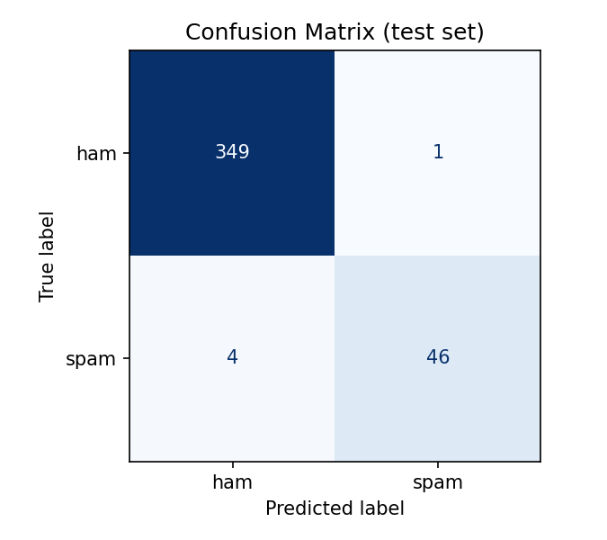
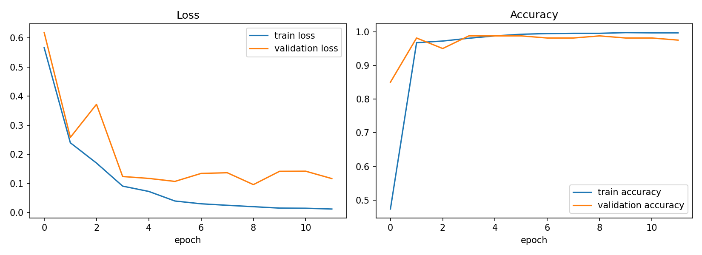

# SMS Spam Detection using LSTM

A deep learning project that classifies SMS messages as **spam** or **ham** (legitimate) using a recurrent neural network (LSTM) built with TensorFlow / Keras.

The project covers the complete pipeline: data loading, cleaning, text preprocessing, tokenization, padding, model training, evaluation (accuracy, precision, recall, F1-score), confusion matrix, and predictions on unseen messages.

---

## Table of Contents

- [Problem Statement](#problem-statement)
- [Dataset](#dataset)
- [Approach](#approach)
- [Model Architecture](#model-architecture)
- [Results](#results)
- [Project Structure](#project-structure)
- [Installation](#installation)
- [Usage](#usage)
- [Design Decisions](#design-decisions)
- [Limitations](#limitations)
- [Acknowledgements](#acknowledgements)
- [Author](#author)

---

## Problem Statement

A mobile communication company wants to identify spam messages automatically. This project trains a sequential deep learning model on a manageable subset of about 2,000 labelled SMS messages and evaluates how well it separates spam from genuine messages.

## Dataset

| Property | Value |
|---|---|
| Source | [SMS Spam Detection Dataset (Kaggle)](https://www.kaggle.com/datasets/vishakhdapat/sms-spam-detection-dataset) |
| File used | `spam_sms.csv` |
| Columns | `v1` (label: ham / spam), `v2` (SMS text) |
| Total messages | 5,572 (4,825 ham, 747 spam) |
| After removing duplicates | 5,158 |
| Subset used for training | 2,000 (1,751 ham, 249 spam), stratified |
| Train / test split | 1,600 / 400 (80 / 20, stratified) |

The data is **imbalanced**: only about 12% of the messages are spam.

## Approach

1. **Load and clean:** read the CSV (utf-8 with latin-1 fallback), detect the label and text columns, check missing values, drop empty rows and duplicate messages, and map labels to `ham = 0`, `spam = 1`.
2. **Subset:** take a stratified sample of 2,000 messages so the spam ratio is preserved.
3. **Preprocess text:** lowercase, replace links with `url`, currency symbols with `money`, numbers with `num`, and strip punctuation.
4. **Split** into train and test sets *before* tokenizing, to prevent data leakage.
5. **Tokenize and pad:** build a 3,000-word vocabulary from training data only, convert messages to integer sequences, and pad or truncate to a fixed length of 35 (the 95th percentile of message length).
6. **Train** the LSTM with class weights, a validation split and early stopping.
7. **Evaluate** with accuracy, precision, recall, F1-score and a confusion matrix.
8. **Predict** on new, unseen SMS messages using the same pipeline.

## Model Architecture

```
Input (35 token ids)
  -> Embedding(3000, 32, mask_zero=True)
  -> LSTM(64)
  -> Dropout(0.3)
  -> Dense(1, sigmoid)
```

| Layer | Output shape | Parameters |
|---|---|---|
| Embedding | (None, 35, 32) | 96,000 |
| LSTM | (None, 64) | 24,832 |
| Dropout | (None, 64) | 0 |
| Dense | (None, 1) | 65 |
| **Total** | | **120,897** |

- **Loss:** binary cross-entropy
- **Optimizer:** Adam (learning rate 1e-3)
- **Batch size:** 32, up to 20 epochs with early stopping (patience 3, best weights restored)

**Why LSTM?** A simple RNN suffers from vanishing gradients and forgets early words. An LSTM's gates and cell state let it carry an important cue (for example "free" or "win") through the whole message to the final decision. A GRU is a lighter alternative and can be swapped in with a single change (`build_model("GRU")`).

## Results

Evaluated on the held-out test set (400 messages, 50 of them spam):

| Metric | Score |
|---|---|
| Accuracy | **98.75%** |
| Precision | **95.92%** |
| Recall | **94.00%** |
| F1-score | **94.95%** |

### Confusion matrix

|  | Predicted ham | Predicted spam |
|---|---|---|
| **Actual ham** | 348 (TN) | 2 (FP) |
| **Actual spam** | 3 (FN) | 47 (TP) |



### Training curves



Validation loss reaches its minimum around epoch 7 and then stops improving, so early stopping halts training and restores the best weights.

### Predictions on unseen messages

| Message | Prediction | P(spam) |
|---|---|---|
| Congratulations! You have won a $1000 gift card. Click http://bit.ly/claim-now ... | SPAM | 0.999 |
| URGENT! Your account has been suspended. Call 09061234567 immediately ... | SPAM | 0.974 |
| Free entry in our weekly draw! Text WIN to 80082 to get a free ringtone | SPAM | 0.998 |
| You have been selected for a free holiday. Reply YES to claim now | SPAM | 0.787 |
| Hey, are we still meeting for lunch at 1pm today? | HAM | 0.002 |
| Can you send me the notes from yesterday's class? I missed it | HAM | 0.001 |
| Mom said dinner is ready, come home soon | HAM | 0.002 |
| Happy birthday da! Party at my place tonight, don't be late | HAM | 0.001 |

### Model comparison (optional run)

Running the script with `--compare` trains Simple RNN, LSTM and GRU with identical settings:

| Model | Parameters | Accuracy | Precision | Recall | F1 |
|---|---|---|---|---|---|
| Simple RNN | 102,273 | 0.9775 | 0.8727 | 0.9600 | 0.9143 |
| **LSTM** | 120,897 | 0.9875 | 0.9592 | 0.9400 | 0.9495 |
| GRU | 114,881 | 0.9750 | 0.8571 | 0.9600 | 0.9057 |

> The test set contains only 50 spam messages, so one or two errors can change these scores by several points. Treat the comparison as indicative, not conclusive.

## Project Structure

```
.
├── sms_spam_detection.py      # full pipeline as a single script
├── sms_spam_detection.ipynb   # same pipeline as a notebook (with outputs)
├── spam_sms.csv               # dataset
├── requirements.txt           # Python dependencies
├── confusion_matrix.png       # generated by the script
├── training_curves.png        # generated by the script
└── README.md
```

## Installation

Python 3.9 to 3.12 is recommended for TensorFlow.

# 1. clone the repository
git clone https://github.com/<your-username>/<your-repo-name>.git
cd <your-repo-name>

# 2. (optional) create a virtual environment
python -m venv venv
source venv/bin/activate        # Windows: venv\Scripts\activate

# 3. install dependencies
pip install -r requirements.txt

## Usage

Make sure `spam_sms.csv` is in the same folder as the script.

bash
# run the full pipeline
python sms_spam_detection.py

# also compare Simple RNN vs LSTM vs GRU
python sms_spam_detection.py --compare

# classify your own messages interactively
python sms_spam_detection.py --interactive


The script prints each step to the terminal, saves `training_curves.png` and `confusion_matrix.png`, and opens the plots at the end (close the plot windows to finish).

To use the notebook instead, open `sms_spam_detection.ipynb` in Jupyter, VS Code or Google Colab and run all cells.

To classify a message in your own code, the same pipeline must be applied as in training:

python
predict_sms(["Free entry! Text WIN to 80082 to claim your prize"])
# [SPAM]  P(spam) = 0.99  |  Free entry! Text WIN to 80082 to claim your prize

## Design Decisions

- **Split before tokenizing:** the vocabulary is built from training data only, so no information leaks from the test set.
- **Duplicates removed:** identical messages in both train and test would inflate the scores.
- **Stop-words kept:** an LSTM learns from word order, and short words such as "to" carry meaning in phrases like "text to win".
- **Class weights:** spam is a minority class, so spam mistakes are penalised more heavily. Without this, a model that predicts "ham" for everything would already reach about 88% accuracy.
- **Masking:** `mask_zero=True` makes the LSTM ignore padding tokens.
- **Early stopping:** stops training when validation loss stops improving, which limits overfitting.
- **Several metrics:** accuracy alone is misleading on imbalanced data, so precision, recall and F1 are reported as well.

## Limitations

- The test set is small (400 messages, 50 spam), so scores vary by a point or two between runs, machines and library versions.
- Trained on a 2,000-message subset of English SMS; performance on other languages or newer spam styles is not tested.
- The decision threshold is fixed at 0.5. Raising it reduces false positives (genuine messages blocked); lowering it reduces false negatives (spam missed).
- This is a learning project, not a production spam filter.

## Acknowledgements

The SMS Spam Collection was originally compiled by Tiago A. Almeida and José María Gómez Hidalgo and is hosted on the UCI Machine Learning Repository. This project uses the Kaggle copy linked above.

Built with [TensorFlow / Keras](https://www.tensorflow.org/), [scikit-learn](https://scikit-learn.org/), [pandas](https://pandas.pydata.org/) and [Matplotlib](https://matplotlib.org/).


## License

Add a license of your choice (for example MIT) as a `LICENSE` file in the repository.
